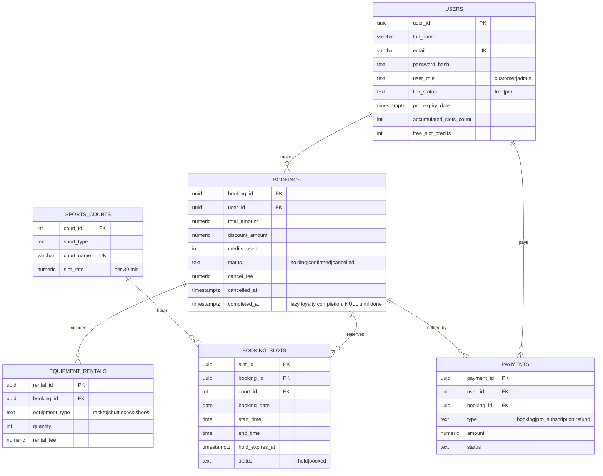

# Match Up ER diagram (draft — matches `backend-api/sql/schema.sql`)

Design notes
- `booking_slots` has `UNIQUE (court_id, booking_date, start_time)`: the database itself prevents double-booking. A row exists only while a slot is held/booked; expired holds are replaced.
- `booking_slots.booking_id` is NOT NULL and `status` is only `held|booked`; cancelling or releasing a hold deletes the row (available = no row). A `held` row must have `hold_expires_at`; `end_time > start_time`.
- `bookings`: partial unique index allows one `holding` booking per user; `completed_at` (only on `confirmed` bookings; there is no `completed` status) is set lazily once the end time has passed; a cancellation writes only a negative `refund` payment, the late fee is the part not refunded (`cancel_fee`); `cancelled` requires `cancelled_at`; amounts are CHECKed >= 0.
- `equipment_rentals` is UNIQUE (booking_id, equipment_type): one row per item per booking. The max quantity (4) lives in `settings.py`/`pricing.py`, not the DB.
- `payments`: refunds are negative rows, all other types are >= 0; a `booking` payment needs a booking_id and a partial unique index allows only one per booking (idempotent confirm).
- Indexes: slot grid by date, hold-expiry sweep, pending-completion scan, payments by created_at/user/booking.
- `payments` is the transaction/subscription log the course requires; admin KPIs and MRR are computed from it.
- Changes from the proposal: `courts.hourly_rate` → `slot_rate` (per 30 min), added `payments`, `credits_used`, `cancel_fee`, `quantity`.
